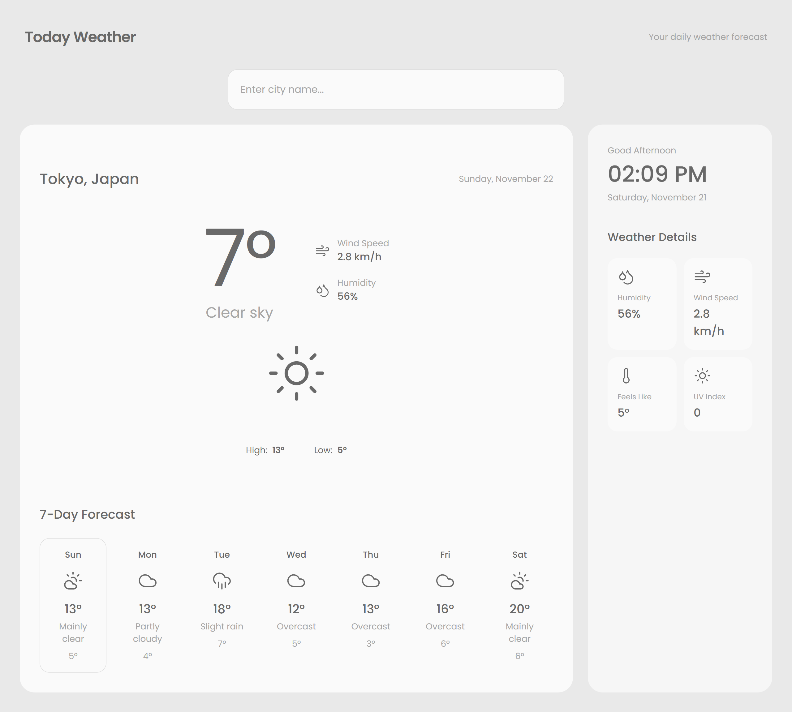

#  Today Weather

<p align="center">
  
  
  
  
</p>

<p align="center">
  A clean, modern, and responsive weather application that helps you explore current weather conditions and 7-day forecasts for cities around the world.
</p>

<p align="center">
  <a href="[YOUR_VERCEL_URL](https://today-weather-pi.vercel.app/)">Live Demo</a> •
  <a href="[YOUR_GITHUB_REPOSITORY_URL](https://github.com/azadinjn/today-weather)">Source Code</a>
</p>

---

##  Preview

<!-- Replace these paths with your actual screenshots -->

<p align="center">
  
</p>

<p align="center">
  <em>Desktop Preview</em>
</p>

<p align="center">
  
</p>

<p align="center">
  <em>Mobile Preview</em>
</p>

---

##  Features

-  **City Search:** Search for cities worldwide with autocomplete suggestions.
-  **Current Weather:** View real-time temperature and weather conditions.
-  **7-Day Forecast:** Check daily weather predictions, including maximum and minimum temperatures.
-  **Weather Details:** View humidity, wind speed, feels-like temperature, and UV index.
-  **Modern UI:** Clean, minimal, and responsive dashboard design.
-  **Skeleton Loading:** Smooth loading experience while fetching weather data.
-  **Error Handling:** Handle unsuccessful requests and search errors.
-  **Responsive Design:** Optimized for desktop, tablet, and mobile devices.

---

##  Built With

| Technology | Usage |
|---|---|
| React | Component-based user interface |
| Vite | Development environment and build tool |
| JavaScript (ES6+) | Application logic and API integration |
| Tailwind CSS v4 | Styling and responsive layouts |
| Lucide React | Modern interface and weather icons |
| HTML5 & CSS3 | Web structure and styling |

---

##  APIs & Data Sources

This application uses the free **Open-Meteo API**, with no API key required.

- **Geocoding API:** Search for cities and retrieve their coordinates.
- **Weather Forecast API:** Retrieve current weather conditions and 7-day forecasts.

Documentation:

- [Open-Meteo Geocoding API](https://open-meteo.com/en/docs/geocoding-api)
- [Open-Meteo Weather API](https://open-meteo.com/en/docs)

---

##  Getting Started

### Prerequisites

- Node.js
- npm
- Git

### Installation

**1. Clone the repository**

```bash
git clone YOUR_GITHUB_REPOSITORY_URL
```

**2. Navigate to the project folder**

```bash
cd today-weather
```

**3. Install dependencies**

```bash
npm install
```

**4. Start the development server**

```bash
npm run dev
```

Open the local URL provided by Vite, usually:

```text
http://localhost:5173
```

### Production Build

Create an optimized production build:

```bash
npm run build
```

Preview the production build locally:

```bash
npm run preview
```

---

##  What I Learned

Building Today Weather helped me practice and improve my skills in:

- Integrating REST APIs using the Fetch API.
- Working with asynchronous JavaScript using `async/await`.
- Handling HTTP responses and JSON data.
- Managing React state and side effects with Hooks.
- Implementing city search and autocomplete.
- Building reusable React components.
- Creating responsive layouts with Tailwind CSS.
- Handling loading states and API errors.
- Using Git and GitHub for version control.
- Deploying a React application with Vercel.

---

##  Deployment

The application is deployed on **Vercel**.

<p align="center">
  <a href="[YOUR_VERCEL_URL](https://today-weather-pi.vercel.app/)">
    
  </a>
</p>

---

##  Acknowledgements

- [Open-Meteo](https://open-meteo.com/) — Free weather and geocoding data.
- [Lucide](https://lucide.dev/) — Beautiful and consistent icons.
- [Vercel](https://vercel.com/) — Application hosting and deployment.

---

<p align="center">
  Made with ❤️ using React
</p>

<p align="center">
  <strong>Today Weather</strong> — Stay informed about the weather, wherever you go.
</p>
