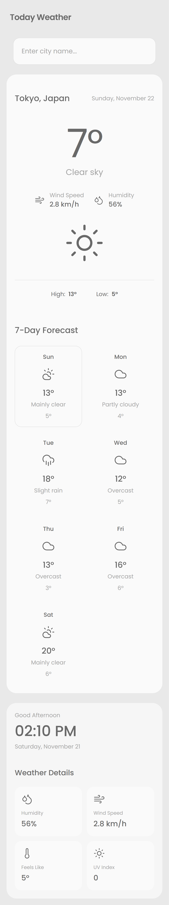

# Today Weather

A modern and responsive weather application that helps users explore current weather conditions and 7-day forecasts for cities around the world.

Built with React, Vite, Tailwind CSS, and the Open-Meteo API.

---

## Screenshots

<!-- Add your screenshots inside the screenshots/ folder -->

### Desktop Preview


### Mobile Preview



---

## Features

- **City Search:** Search for cities around the world with autocomplete suggestions.
- **Current Weather:** View current temperature and weather conditions.
- **7-Day Forecast:** Explore daily weather forecasts, including maximum and minimum temperatures.
- **Weather Details:** Get additional information such as humidity, wind speed, feels-like temperature, and UV index.
- **Loading States:** Skeleton loading UI while weather data is being fetched.
- **Error Handling:** Handle API errors and unsuccessful searches.
- **Responsive Design:** Optimized for desktop, tablet, and mobile screens.
- **Dynamic Weather Icons:** Weather conditions are displayed using Lucide icons.

---

## Technologies Used

| Technology | Purpose |
|---|---|
| React | Building the user interface |
| Vite | Development server and build tool |
| JavaScript (ES6+) | Application logic |
| Tailwind CSS v4 | Styling and responsive design |
| Lucide React | UI and weather icons |
| HTML5 | Application structure |
| CSS3 | Custom styling |

---

## APIs

This project uses the free **Open-Meteo APIs** without requiring an API key.

- **Geocoding API:** Searches for cities and retrieves their geographic coordinates.
- **Weather Forecast API:** Retrieves current weather conditions and 7-day forecasts.

API Documentation:

- [Open-Meteo Geocoding API](https://open-meteo.com/en/docs/geocoding-api)
- [Open-Meteo Weather API](https://open-meteo.com/en/docs)

---

## Project Structure

```text
today-weather/
│
├── public/
│   └── weather-icons/
│
├── screenshots/
│   ├── desktop.png
│   └── mobile.png
│
├── src/
│   ├── assets/
│   │   └── images/
│   │
│   ├── components/
│   │   ├── Header.jsx
│   │   ├── SearchBar.jsx
│   │   ├── CurrentWeather.jsx
│   │   ├── WeatherDetails.jsx
│   │   ├── WeeklyForecast.jsx
│   │   ├── ForecastCard.jsx
│   │   ├── Sidebar.jsx
│   │   ├── WeatherSkeleton.jsx
│   │   ├── Loading.jsx
│   │   └── ErrorMessage.jsx
│   │
│   ├── services/
│   │   ├── geocodingApi.js
│   │   └── weatherApi.js
│   │
│   ├── utils/
│   │   ├── weatherCodes.js
│   │   └── formatDate.js
│   │
│   ├── App.jsx
│   ├── main.jsx
│   └── index.css
│
├── .gitignore
├── package.json
└── README.md
```

---

## Getting Started

### Prerequisites

Make sure you have installed:

- [Node.js](https://nodejs.org/)
- npm (included with Node.js)
- Git

### Installation

**1. Clone the repository**

```bash
git clone YOUR_GITHUB_REPOSITORY_URL
```

**2. Navigate to the project directory**

```bash
cd today-weather
```

**3. Install dependencies**

```bash
npm install
```

**4. Start the development server**

```bash
npm run dev
```

Open the local URL displayed in your terminal, usually:

```text
http://localhost:5173
```

---

## Build for Production

To create an optimized production build:

```bash
npm run build
```

To preview the production build locally:

```bash
npm run preview
```

---

## What I Learned

While building this project, I practiced and improved my skills in:

- Working with REST APIs using the Fetch API.
- Understanding HTTP requests and JSON responses.
- Handling asynchronous JavaScript with `async/await`.
- Managing state and side effects with React Hooks.
- Implementing city search and autocomplete functionality.
- Organizing a React application using reusable components.
- Creating responsive interfaces with Tailwind CSS.
- Handling loading states and API errors.
- Using Git and GitHub for version control.

---

## Acknowledgements

- [Open-Meteo](https://open-meteo.com/) for providing free weather and geocoding APIs.
- [Lucide](https://lucide.dev/) for the icon library.

---

**Built with React and a passion for learning web development.**